# SADR — cvičenia s vysvetlením grafov a testov v R

[← Navigácia predmetu](../README.md) · [Teória a videá →](../prednasky/README.md)

Pri každom postupe nájdeš praktickú otázku, dôvod jeho výberu, použitie, interpretáciu a obmedzenia. Príklady vychádzajú z miestnych skriptov a PDF; obrázky sú vytvorené v R z uvedených dát. Číselné závery platia pre dáta uložené v tomto repozitári.

## Navigácia podľa týždňov

1. [Základy R, import a simulácie](#tyzden-1) — objekty, vektory, matice, tabuľky, faktory, filtrovanie, kocka a prvé grafy.
2. [EDA a čítanie grafov](#tyzden-2) — chýbajúce hodnoty, početnosti, opisné štatistiky, histogram, boxplot, husľový graf, jitter a empirická CDF.
3. [Intervaly spoľahlivosti a bootstrap](#tyzden-3) — interval priemeru a rozptylu, jednostranné hranice, skupiny, intervalový graf a simulované pokrytie.
4. [Testy jedného výberu a párov](#tyzden-4) — Q-Q graf, Shapiro–Wilk, z-test, t-test, chí-kvadrát test rozptylu a merania pred/po.
5. [Nezávislé výbery a ANOVA](#tyzden-5) — F-test, združený/Welchov t-test, Bartlett/Levene, ANOVA, Tukey/Scheffé/Games–Howell, miery efektu, rezíduá a interakcie.

Ďalšia navigácia: [Ako spúšťať kód](#spustenie) · [Výber testu podľa otázky](#vyber-testu) · [Doplnkové pracovné listy](#doplnky) · [Obnovenie obrázkov](#obrazky).

Materiály druhého týždňa sú uložené v `01/SADR2.*`; samostatný priečinok `02` tu nie je. Poradie týždňov sa riadi témami a číslami materiálov, nie dátumom exportu PDF.

<a id="spustenie"></a>
## Ako spúšťať ukážky

**Pracovným adresárom je koreň repozitára `SADR`**, nie priečinok `cvicenia`. Takto budú fungovať všetky cesty. Ak otvoríš pôvodný `.Rproj` priamo v týždennom priečinku, pracovný adresár bude iný; uprav ho pred spustením týchto ukážok. Over ho pomocou `getwd()`.

Základné výpočty používa R bez ďalších balíkov. Ostatné ukážky potrebujú `readxl`, `tibble`, `ggplot2`, `viridisLite`, `vioplot`, `moments`, `DescTools`, `EnvStats`, `Rmisc`, `mosaic` a `car`. Balík stačí nainštalovať raz; `library()` ho načítava pre aktuálne spustenie. Inštaláciu spusti iba pre chýbajúce balíky, napríklad `install.packages("readxl")`.

V RStudio spúšťaj výrazy alebo označené bloky postupne. Pri uložení ukážok do skriptu použi **Source with Echo**, resp. `source("subor.R", echo = TRUE)`. Samotná premenná v konzole vypíše výsledok. Súvisiace bloky v rámci týždňa nadväzujú na jeho úvodný blok; pri novom týždni sa potrebné dáta načítavajú znova.

Vlastné názvy a komentáre kódu sú malé a bez diakritiky; názvy súborov, stĺpcov a balíkov zostávajú presné. Text vysvetlenia používa slovenčinu s diakritikou. Vzorce sú zapísané v LaTeXu pre Markdown s podporou matematiky.

<a id="vyber-testu"></a>
## Výber testu podľa praktickej otázky

| Čo potrebujem zistiť | Čo musím vedieť o meraniach | Postup |
|---|---|---|
| Ako dáta vyzerajú? | Typ premennej, jednotky, chýbajúce údaje. | EDA a grafy; zatiaľ netestujem. |
| Je normálny model primeraný? | Správna skupina, rozdiely alebo rezíduá podľa následného modelu. | Q-Q graf + Shapiro–Wilk. |
| Aká je neistota priemerného času? | Nezávislý výber, známe/neznáme populačné σ. | z-interval/t-interval. |
| Líši sa priemerný čas od 55 s? | Jeden výber; známe/neznáme populačné σ. | z-test/jednovýberový t-test. |
| Sú merania rozptýlenejšie než povoľuje norma? | Jeden normálny výber, limit rozptylu. | Chí-kvadrát test jedného rozptylu. |
| Zlepšili sa tí istí žiaci po tréningu? | Správne spárované merania, rozdiely medzi pármi nezávislé. | Párový t-test. |
| Líšia sa priemery dvoch nezávislých dodávateľov? | Nezávislé skupiny; rovnaký rozptyl netreba predpokladať. | Welchov t-test; združený t-test pri odôvodnenom spoločnom rozptyle. |
| Majú dve/viaceré skupiny rovnakú variabilitu? | Normalita a odolnosť voči extrémom ovplyvňujú výber. | F-test pre dva normálne výbery, Bartlett pre normálne skupiny, Levene/Brown–Forsythe ako robustnejšia diagnostika. |
| Líšia sa priemery troch kategórií? | Nezávislosť, normálny model chýb, homogenita. | Jednofaktorová ANOVA; pri nerovnakých rozptyloch Welchova ANOVA. |
| Ktoré dvojice sa líšia? | Zodpovedajúci model a korekcia na viac porovnaní. | Tukey/Scheffé alebo Games–Howell. |
| Závisí dopad latencie od UI? | Dva faktory, opakovania v kombináciách, vhodný model chýb. | Dvojfaktorová ANOVA s interakciou + interakčný graf. |

Hladinu $\alpha$, často 0,05, a smer alternatívy zvoľ **pred** vyhodnotením. Pri $p\leq\alpha$ zamietame príslušnú nulovú hypotézu; pri $p>\alpha$ ju nezamietame. To nie je dôkaz jej pravdivosti. Diagnostická p-hodnota nie je automatický prepínač medzi metódami: ber do úvahy návrh zberu, veľkosť vzorky a grafy.

<a id="tyzden-1"></a>
## 1. týždeň: Základy R, import a simulácie

**Podklady:** [SADR.R](01/SADR.R), [SADR1.pdf](01/SADR1.pdf), [HTML](01/SADR.html) · [Teória a videá](../prednasky/README.md#tyzden-1)

### 1.1 Výrazy, vektory a indexovanie

R počíta s celými vektormi. Priradenie `<-` uloží objekt, `==` porovnáva, `=` sa často používa pri pomenovaní argumentu. Indexy začínajú jednotkou. `&`, `|` a `!` znamenajú po zložkách „a“, „alebo“ a negáciu. Chýbajúca hodnota `NA` sa testuje cez `is.na()`, nie cez `x == NA`.

```r
2^3
sqrt(9)
14 %% 3
14 %/% 3
log(10)
log10(10)
exp(1)
factorial(5)
choose(5, 2)

x <- c(2, 3, 4)
class(x)
class(5L)
as.integer(x)
length(x)
sum(x)
prod(x)
cumsum(x)
x^2
x[c(1, 3)]
x[x > 2]
seq(1, 9, by = 2)
rep(x, each = 2)
```

**Prečo:** Ak potrebujeme priemerný čas 20 požiadaviek, `mean(cas)` pracuje priamo so všetkými časmi. Pri dvoch vektoroch rôznej dĺžky R opakuje kratší (**recycling**), čo môže vytvoriť neúmyselný výpočet; pred párovým odčítaním over dĺžku aj poradie objektov. `Inf` je nekonečno, `NaN` nedefinovaný číselný výsledok; nejde o to isté ako chýbajúce meranie `NA`.

### 1.2 Matice, dátové tabuľky, zoznamy a faktory

Matica má prvky rovnakého typu. Dátová tabuľka môže mať v jednotlivých stĺpcoch rôzne typy. Zoznam môže uchovávať napríklad výsledok testu; z neho vyberáme `test$p.value`. Faktor reprezentuje kategórie a jeho úrovne sa v modeli neposudzujú ako číselná vzdialenosť.

```r
a <- matrix(1:12, nrow = 3, byrow = TRUE)
a[2, 3]
a[, 1]
t(a)
cbind(a, a)
rbind(a, a)

studenti <- data.frame(
  meno = c("jan", "iva", "eva", "oto", "ivo"),
  vek = c(18, 20, 21, 22, 19),
  body = c(10, 12, 15, 0, 20),
  studium = factor(c("umint", "umint", "iss", "iss", "umint"))
)
studenti$body
studenti[studenti$vek >= 20 & studenti$body > 0, ]
subset(studenti, studium == "umint")
tibble::as_tibble(studenti)
zoznam <- list(priemer = mean(studenti$body), pocet = nrow(studenti))
zoznam$priemer
```

**Príklad:** Vzdelanie s kódmi 1, 2, 3 v ANOVA prevedieme na `factor`. Ak by sme použili číselný kód bez prevodu, model by mohol testovať iba lineárny trend na vymyslenej číselnej škále, namiesto všeobecného rozdielu troch priemerov.

### 1.3 Import a prvá kontrola dát

```r
diabetes <- read.csv("cvicenia/01/data/diabetes.csv")
data <- as.data.frame(readxl::read_xlsx("cvicenia/01/data/data_vyuka.xlsx"))
str(data)
names(data)
head(data)
dim(data)
summary(data)
colSums(is.na(data))
```

`str()` preverí typy, `head()` prvé riadky, `summary()` rozsahy a chýbajúce hodnoty. Dataset `data_vyuka.xlsx` má 50 riadkov a 13 stĺpcov; príjem `mprij` chýba v piatich riadkoch. V `diabetes.csv` môžu niektoré nuly znamenať chýbajúce fyziologické meranie; pred zmenou treba poznať význam konkrétneho stĺpca. Nula pri počte tehotenstiev môže byť platná, preto sa nuly nenahrádzajú plošne.

Voliteľný export: `write.csv(studenti, "export_studenti.csv", row.names = FALSE)` alebo `writexl::write_xlsx(studenti, "export_studenti.xlsx")`. Export nemení význam faktorov na štatistický dôkaz; ide len o uloženie dát.

### 1.4 Simulácia kocky: prečo početnosť kolíše

**Otázka:** Prečo pri desiatich hodoch nepadne každé číslo presne šestinu času? Krátka séria má veľkú náhodnú variabilitu. Simulácia pomáha pochopiť rozdiel medzi pravdepodobnosťou modelu a pozorovanou relatívnou početnosťou.

```r
set.seed(2026)
hod <- sample(1:6, size = 10000, replace = TRUE)
pocetnosti <- table(factor(hod, levels = 1:6))
pocetnosti
prop.table(pocetnosti)

barplot(prop.table(pocetnosti), col = viridisLite::viridis(6),
        xlab = "hodnota na kocke", ylab = "relativna pocetnost")
abline(h = 1/6, lty = 2)

plot(cumsum(hod == 6)/seq_along(hod), type = "l", log = "x",
     xlab = "pocet hodov", ylab = "podiel sestiek")
abline(h = 1/6, lty = 2)
```

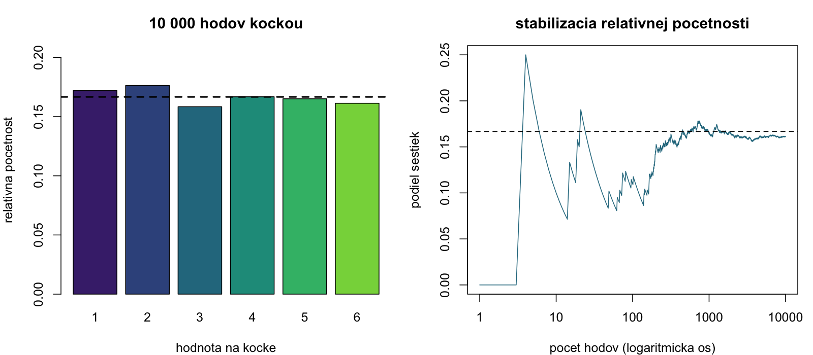

**Ako čítať:** Vľavo porovnávame kategórie s teoretickou čiarou $1/6$. Vpravo každý bod zahŕňa všetky dovtedajšie hody, vodorovná os je logaritmická. Podiel sa stabilizuje, ale nepribližuje sa k čiare monotónne. `set.seed()` umožňuje zopakovať rovnakú simuláciu; `replace = TRUE` umožňuje opakovanie výsledkov. `factor(..., levels = 1:6)` zachová aj kategóriu s nulovou početnosťou.

Stĺpcový graf je tu prirodzený, lebo ide o šesť diskrétnych hodnôt. Histogram príjmov z ďalšieho týždňa naopak rozdeľuje číselnú os na intervaly. Graf funkcie, napríklad `plot(sin, from = -2*pi, to = 2*pi)`, zobrazuje matematický predpis a sám nie je opisom nameranej vzorky.

[↑ Navigácia](#navigácia-podľa-týždňov)

<a id="tyzden-2"></a>
## 2. týždeň: EDA a čítanie grafov

**Podklady:** [SADR2.R](01/SADR2.R), [SADR2.pdf](01/SADR2.pdf), [HTML](01/SADR2.html) · [Teória a videá](../prednasky/README.md#tyzden-2)

### 2.1 Chýbajúce údaje: čo odstrániť a prečo

**Otázka:** Z koľkých osôb naozaj počítame priemerný príjem? `mean()` s `NA` nedá číselný priemer, kým nepovieme, ako s chýbaním naložiť. Pri čistení vyberáme iba premenné potrebné pre danú analýzu, aby chýbajúci údaj v nesúvisiacom stĺpci zbytočne nevyhodil celé pozorovanie.

```r
data <- as.data.frame(readxl::read_xlsx("cvicenia/01/data/data_vyuka.xlsx"))
colSums(is.na(data))
prijmy <- na.omit(data[c("mprij", "pohlavie", "vzdelanie")])
nrow(prijmy)
plat <- prijmy$mprij
mean(data$mprij, na.rm = TRUE)
```

V tejto konkrétnej tabuľke zostane 45 riadkov; rovnaký počet dá aj pôvodné `na.omit(data)`. Všeobecne sa tieto postupy líšia. Vynechanie riadkov môže skresliť výsledok, ak napríklad najvyššie príjmy chýbajú častejšie; `na.rm = TRUE` toto skreslenie neodstráni.

Balíky `mice::md.pattern(data)` a `Amelia::missmap(data)` z pôvodného cvičenia ukazujú vzory chýbania: ktoré stĺpce a riadky chýbajú spoločne. Sú užitočné pred rozhodnutím o dopĺňaní, ale samy hodnoty nedopĺňajú a nedokazujú náhodný mechanizmus chýbania.

### 2.2 Početnosti a opisné charakteristiky

```r
table(plat)
prop.table(table(plat))
cumsum(table(plat))
triedy <- hist(plat, breaks = "Sturges", plot = FALSE)
triedy$breaks
triedy$counts

mean(plat)
median(plat)
pocetnosti <- table(plat)
names(pocetnosti)[pocetnosti == max(pocetnosti)]
quantile(plat, c(0.25, 0.5, 0.75), type = 2)
range(plat)
diff(range(plat))
var(plat)
sd(plat)
IQR(plat)
mean(abs(plat - mean(plat)))
mad(plat)
sd(plat)/mean(plat)*100
moments::skewness(plat)
moments::kurtosis(plat)
tapply(prijmy$mprij, prijmy$pohlavie, mean)
tapply(prijmy$mprij, prijmy$vzdelanie, summary)
```

**Prečo viac čísel:** Priemer opisuje sumu rozdelenú počtom, medián typickú prostrednú osobu a odchýlka rozptýlenie príjmov. V dátach je priemer **1 113,33 €**, medián **1 050 €**, odchýlka **323,36 €** a rozsah **600–1 950 €**. Vyšší priemer než medián je užitočný signál na preskúmanie pravého chvosta, nie samostatný dôkaz konkrétneho rozdelenia.

`range()` vracia dve hranice; variačné rozpätie je ich rozdiel. `mad()` je škálovaná **mediánová** absolútna odchýlka, nie `mean(abs(plat - mean(plat)))`. `moments::kurtosis()` používa špicatosť s normálnou referenciou 3; exces získame odčítaním 3. Výsledky kvantilov a `IQR()` môžu používať iné konvencie než `type = 2`; pri porovnávaní ich zjednoť.

Priemer rastových koeficientov a rýchlostí si over na účele výpočtu:

```r
rast <- c(12000/10000, 12500/12000)
exp(mean(log(rast))) - 1
rychlosti <- c(20, 80)
length(rychlosti)/sum(1/rychlosti)
```

Prvý výsledok je priemerný relatívny rast za dve obdobia, druhý priemerná rýchlosť pri rovnako dlhých úsekoch. Geometrický priemer kladných koeficientov nie je aritmetický priemer percent.

### 2.3 Histogram: tvar rozdelenia a početnosti

**Na čo a prečo:** Predstav si príjmy dvoch firiem s rovnakým priemerom. V jednej majú takmer všetci podobnú mzdu, v druhej väčšina nízku a pár ľudí veľmi vysokú. Histogram tento rozdiel ukáže, samotný priemer nie.

```r
farby <- viridisLite::viridis(3, end = 0.8)
hist(plat, breaks = "Sturges", col = farby[2], border = "white",
     main = "rozdelenie prijmov", xlab = "mesacny prijem (eur)",
     ylab = "pocet osob")
abline(v = mean(plat), col = farby[1], lwd = 2)
abline(v = median(plat), col = farby[3], lwd = 2, lty = 2)
```

**Ako čítať:** Stĺpec počíta ľudí v intervale príjmov. Sleduj polohu, počet vrcholov, chvosty, medzery a extrémy. Vyskúšaj iný počet tried: štruktúra, ktorá zmizne po malej zmene hraníc, môže byť len dôsledok zvoleného delenia. Na porovnanie rozdelení rôzne veľkých skupín použi hustotu alebo relatívne početnosti, nie surové počty.

### 2.4 Boxplot: porovnanie polohy, variability a extrémov

**Na čo a prečo:** Chceme rýchlo porovnať príjmy podľa pohlavia alebo vzdelania. Boxplot je úspornejší než niekoľko histogramov a súčasne ukáže medián, stredných 50 % hodnôt aj potenciálne odľahlé body.

```r
boxplot(mprij ~ pohlavie, data = prijmy,
        col = viridisLite::viridis(2, end = 0.8),
        xlab = "pohlavie", ylab = "mesacny prijem (eur)")
boxplot.stats(plat)
```

**Ako čítať:** Čiara v boxe je medián, spodok a vrch sú Tukeyho závesy blízke kvartilom. Fúzy siahajú po najkrajnejšie pozorovania v pravidle 1,5 IQR; body za nimi sú kandidáti na kontrolu. V malých vzorkách sa závesy môžu mierne líšiť od `quantile()`.

Vyšší box znamená vyššiu polohu, dlhší box väčší IQR. `outline = FALSE` iba skryje odľahlé body, nevymaže ich z dát. `range = 0` v `boxplot()` natiahne fúzy na minimum/maximum. Prekrývanie boxov nie je test rovnosti priemerov a samotný boxplot neukáže spoľahlivo počet vrcholov ani počet osôb.

### 2.5 Husľový graf: čo boxplot skryje

**Na čo a prečo:** Dve skupiny môžu mať rovnaký medián aj kvartily, ale jedna môže obsahovať dve oddelené príjmové podskupiny. Husľový graf zobrazí vyhladenú hustotu a pomôže takú štruktúru spozorovať.

```r
vioplot::vioplot(mprij ~ pohlavie, data = prijmy,
                col = viridisLite::viridis(2, end = 0.8),
                xlab = "pohlavie", ylab = "mesacny prijem (eur)")
```

**Ako čítať:** Širšia časť označuje väčšiu odhadovanú hustotu pri danej výške. Nie je to automaticky väčší počet osôb v skupine; záleží na škálovaní. Pri malej vzorke výsledok výrazne ovplyvní vyhladenie, preto ho dopĺňame bodmi alebo boxplotom.

### 2.6 Jitter: jednotlivé merania a prekrývanie

**Na čo a prečo:** Ak má desať osôb príjem 900 €, v obyčajnom bodovom grafe sa môžu zobraziť ako jediný bod. Jitter ich mierne odsunie, aby sme videli koncentráciu meraní a približnú veľkosť skupín.

```r
library(ggplot2)
ggplot(prijmy, aes(factor(vzdelanie), mprij, color = factor(vzdelanie))) +
  geom_boxplot(outlier.shape = NA, width = 0.45, color = "grey45") +
  geom_jitter(size = 2.3,
              position = position_jitter(width = 0.12, height = 0, seed = 2026)) +
  scale_color_viridis_d(begin = 0.1, end = 0.75, guide = "none") +
  labs(x = "kod vzdelania", y = "mesacny prijem (eur)") +
  theme_minimal()
```

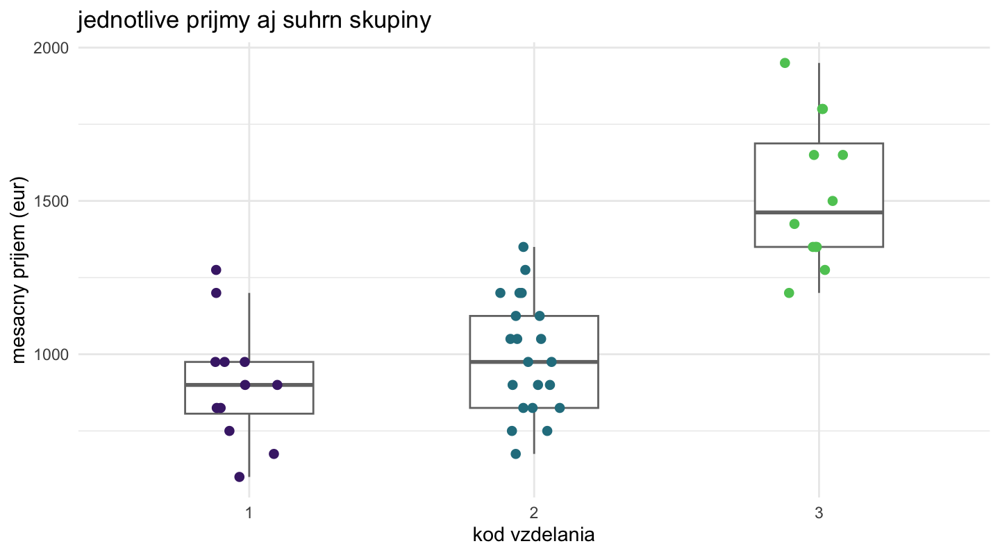

**Ako čítať:** Výška bodu zostáva skutočným príjmom; náhodne meníme iba vodorovnú pozíciu v rámci kategórie. Zhluk bodov opisuje dáta, box ich súhrn. Rozdelenie príjmov sa medzi kategóriami líši, ale graf sám nedokazuje príčinu ani významnosť.

### 2.7 Empirická distribučná funkcia: podiel pod hranicou

**Na čo a prečo:** Na otázku „aký podiel ľudí má príjem najviac 1 200 €?“ je CDF priamejšia než odhadovanie plochy histogramu. Nezávisí od voľby intervalov.

```r
distribucia <- ecdf(plat)
distribucia(1200)
mean(plat <= 1200)
plot(distribucia, verticals = TRUE,
     xlab = "mesacny prijem (eur)", ylab = "podiel prijmov <= x")
```

**Ako čítať:** Na osi y je podiel od 0 do 1, na osi x hranica príjmu. Funkcia v bode 1 200 dá podiel meraní najviac 1 200. Rozdiel výšok $F_n(b)-F_n(a)$ je podiel hodnôt v intervale $(a,b]$. Výrazný skok znamená opakovanú hodnotu. Je to opis vzorky, nie hladká známa populačná CDF.

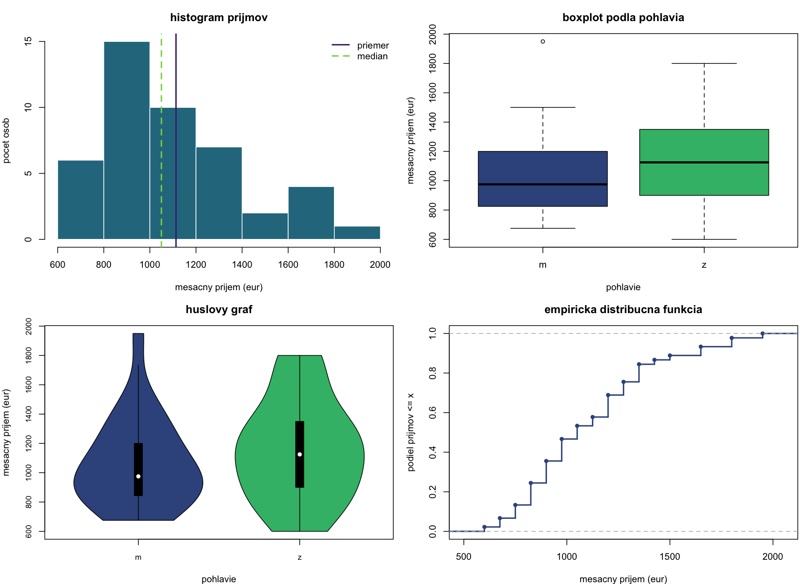

**Prečo kombinovať grafy:** Histogram/husle ukážu tvar, boxplot úsporné porovnanie a CDF kumulatívne podiely. Jeden graf neodpovie na všetky otázky.

[↑ Navigácia](#navigácia-podľa-týždňov)

<a id="tyzden-3"></a>
## 3. týždeň: Intervaly spoľahlivosti a bootstrap

**Podklady:** [SADR3.R](03/SADR3.R), [SADR3.pdf](03/SADR3.pdf), [data_vyuka.xlsx](03/data_vyuka.xlsx) · [Teória, vzorce a videá](../prednasky/README.md#tyzden-3)

### 3.1 Spoločné dáta a praktická otázka

**Otázka:** Aký je priemerný čas na webe a ako presne ho z dvadsiatich návštev poznáme? Odchýlka návštev nie je to isté ako neistota ich priemeru. Priemer je 54,7 s, smerodajná odchýlka približne 4,1052 s a odhad štandardnej chyby približne 0,9179 s.

```r
cas <- c(48,55,51,62,53,58,60,50,49,57,52,61,54,56,59,53,50,58,55,53)
alfa <- 0.05
n <- length(cas)
mean(cas)
sd(cas)
sd(cas)/sqrt(n)
qqnorm(cas)
qqline(cas)
shapiro.test(cas)
```

Q-Q graf a test tu neukazujú výrazný nesúlad s normálnym modelom; $p\approx0{,}7459$ nie je dôkaz normality. Nezávislosť návštev musíme odôvodniť zberom dát, nie týmto testom. [Význam diagnostiky](#normalita).

### 3.2 Priemer pri známej populačnej odchýlke

**Prečo z-interval:** Ak z nezávislej informácie skutočne poznáme populačné $\sigma=3{,}8$, nemusíme jeho neistotu odhadovať z výberu. Použijeme normálny kvantil a štandardnú chybu $\sigma/\sqrt n$.

```r
sigma <- 3.8
is_z <- mean(cas) + c(-1, 1)*qnorm(1 - alfa/2)*sigma/sqrt(n)
is_z
DescTools::ZTest(cas, sd_pop = sigma)$conf.int

dolny_z <- c(mean(cas) - qnorm(1 - alfa)*sigma/sqrt(n), Inf)
horny_z <- c(-Inf, mean(cas) + qnorm(1 - alfa)*sigma/sqrt(n))
dolny_z
horny_z
```

95 % obojstranný interval je **[53,0346; 56,3654] s**, dolný jednostranný **[53,3024; ∞)**, horný **(−∞; 56,0976]**. Jednostranná hranica používa `qnorm(0.95)`, obojstranná `qnorm(0.975)`. Dolná hranica je užitočná, ak potrebujeme odhad minimálnej úrovne priemerného času; horná napríklad pri posudzovaní priemernej čakacej doby.

`ZTest()` bez `mu` súčasne vypisuje test proti nule. Keď chceme len interval, čítame `$conf.int` a p-hodnotu tohto nesúvisiaceho testu neinterpretujeme.

### 3.3 Priemer pri neznámej odchýlke: t-interval

**Prečo:** V praxi spravidla poznáme len výberové `sd(cas)`. Studentov interval zohľadní, že populačný rozptyl odhadujeme z rovnakých dát.

```r
is_t <- stats::t.test(cas, conf.level = 0.95)$conf.int
is_t
mean(cas) + c(-1, 1)*qt(1 - alfa/2, df = n - 1)*sd(cas)/sqrt(n)
stats::t.test(cas, alternative = "greater")$conf.int
stats::t.test(cas, alternative = "less")$conf.int
stats::t.test(cas, conf.level = 0.90)$conf.int
Rmisc::CI(cas, ci = 0.95)
```

Výsledok je **[52,7787; 56,6213] s**; pri rovnakých dátach je širší než z-interval. `greater` vracia dolnú konečnú hranicu a nekonečno, `less` záporné nekonečno a hornú konečnú hranicu. `conf.level = 0.90` znamená 90 % spoľahlivosť, nie $\alpha=0{,}90$. `Rmisc::CI()` vracia poradie `upper`, `mean`, `lower`; hranice čítaj podľa názvu.

**Ako povedať záver:** „Priemerný čas odhadujeme na 54,7 s, 95 % t-interval je 52,78 až 56,62 s.“ Toto rozmedzie neopisuje 95 % jednotlivých návštev ani maximálny čas.

### 3.4 Intervalový graf a skupinové intervaly

**Na čo a prečo:** Bodový odhad s intervalom ukáže, či dva podobné priemery poznáme rovnako presne. Samotný stĺpec priemeru neistotu skrýva. Nižšie sa hranice počítajú z dát, nie ručne prepisujú zo starého výstupu.

```r
data <- as.data.frame(readxl::read_xlsx("cvicenia/03/data_vyuka.xlsx"))
prijmy <- na.omit(data[c("mprij", "pohlavie", "vzdelanie")])
intervaly <- Rmisc::group.CI(mprij ~ pohlavie, data = prijmy)
intervaly

library(ggplot2)
ggplot(intervaly, aes(pohlavie, mprij.mean,
                     ymin = mprij.lower, ymax = mprij.upper, color = pohlavie)) +
  geom_pointrange() +
  scale_color_viridis_d(begin = 0.1, end = 0.75, guide = "none") +
  labs(x = "pohlavie", y = "priemerny prijem a 95 % interval (eur)") +
  theme_minimal()
```

**Ako čítať:** Bod je priemer, úsečka interval populačného priemeru. Širší interval znamená väčšiu neistotu, čo môže byť spôsobené väčším rozptylom aj menším počtom osôb. Prekryv dvoch intervalov **nenahrádza test rozdielu**; pre porovnanie chceme interval rozdielu alebo vhodný dvojvýberový test.

### 3.5 Rozptyl a smerodajná odchýlka

**Príklad a dôvod:** Dva procesy môžu mať rovnaký priemerný čas, ale jeden je výrazne nepredvídateľnejší. Interval rozptylu určuje neistotu tejto nestability. Presný chí-kvadrát postup vyžaduje normálne nezávislé pozorovania.

```r
is_var <- (n - 1)*var(cas)/qchisq(c(1 - alfa/2, alfa/2), df = n - 1)
is_var
sqrt(is_var)
DescTools::VarTest(cas, conf.level = 0.95)$conf.int
```

95 % interval rozptylu je približne **[9,7466; 35,9512] s²**. Interval odchýlky dostaneme cez `sqrt(is_var)` a jeho jednotka je sekunda. Kvantily sú v menovateli v opačnom poradí, aby dolná hranica bola menšia než horná. `stats::var.test()` porovnáva **dva** rozptyly, nejde o náhradu `DescTools::VarTest()` pre jeden výber.

### 3.6 Pokrytie intervalov: čo znamená 95 %

**Prečo simulovať:** Z jediného reálneho intervalu nevidíme, či obsahuje neznámy parameter. V simulácii parameter poznáme a môžeme overiť správanie celého postupu.

```r
set.seed(2026)
intervaly <- matrix(NA_real_, nrow = 60, ncol = 2)
for (i in 1:60) {
  vyber <- rnorm(30, mean = 3, sd = 1)
  intervaly[i, ] <- stats::t.test(vyber)$conf.int
}
pokryva <- intervaly[, 1] <= 3 & intervaly[, 2] >= 3
sum(pokryva)
mean(pokryva)
```

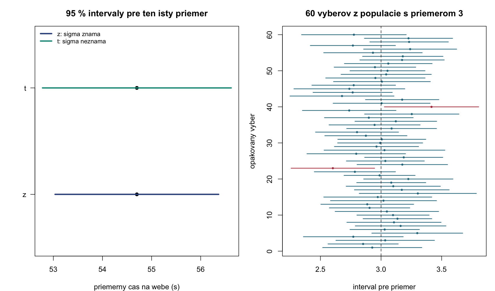

**Ako čítať:** Vľavo je neistota toho istého priemeru pri rôznych informáciách o rozptyle. Vpravo sú intervaly zo 60 rôznych vzoriek; zvislá čiara je stále ten istý populačný priemer 3. Červené intervaly ho minuli. Nemusí ich byť presne 5 % v každej simulácii; 95 % je dlhodobá vlastnosť metódy.

### 3.7 Bootstrap a histogram bootstrapových odhadov

**Otázka:** Ako odhadnúť neistotu priemeru alebo mediánu, keď nemáme vhodný jednoduchý parametrický vzorec? Bootstrap napodobní opakované výbery prevzorkovaním aktuálnych dát **s vracaním**. Nižšie je príklad z cvičenia; prednáška navyše používa dlhšiu vzorku, preto jej priemer nie je rovnaký.

```r
x <- c(2, 2, 3, 4, 5, 11, 3, 12, 15, 21)
set.seed(2026)
boot_priemery <- numeric(10000)
for (i in seq_along(boot_priemery)) {
  boot_priemery[i] <- mean(sample(x, size = length(x), replace = TRUE))
}
mean(x)
sd(boot_priemery)
is_boot <- quantile(boot_priemery, c(0.025, 0.975))
is_boot
2*mean(x) - rev(is_boot)

hist(boot_priemery, breaks = 40, col = viridisLite::viridis(3)[2],
     border = "white", xlab = "bootstrapovy priemer", main = "neistota priemeru")
abline(v = is_boot, lty = 2)
```

`sd(boot_priemery)` je odhad **štandardnej chyby priemeru**. Nejde o `sd(x)`, ktorá opisuje jednotlivé merania. Kvantily dávajú percentilový interval; posledný výpočet dá basic/reverzný interval. Na odhad mediánu nahraď v tele cyklu `mean()` za `median()` a potom v basic intervale použi pôvodný medián.

Kratší zápis z materiálov používa `mosaic`:

```r
library(mosaic)
set.seed(2026)
boot_data <- do(10000) * mean(resample(x))
head(boot_data)
confint(boot_data)
```

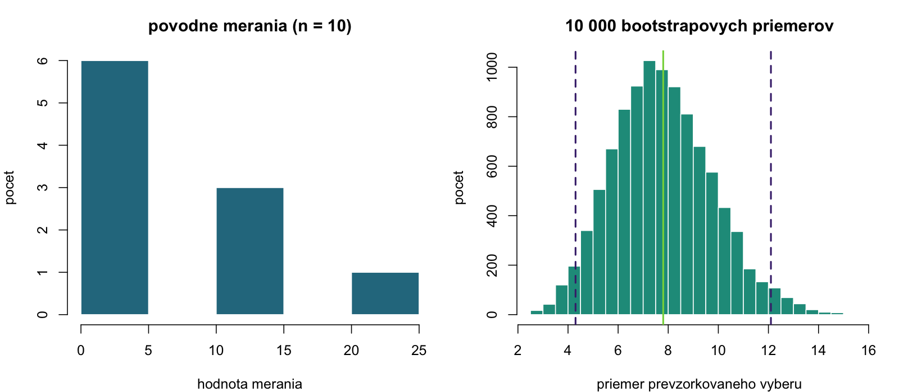

**Ako čítať:** Vľavo sú jednotlivé namerané hodnoty. Vpravo sú priemery z 10 000 prevzorkovaní; ide o iný druh premennej. Čiarkované hranice označujú 2,5. a 97,5. percentil. Užší tvar vpravo neznamená, že pôvodné merania sú menej variabilné.

**Obmedzenia:** Desať meraní môže slabo reprezentovať chvosty populácie. Bežné prevzorkovanie predpokladá nezávislosť a neodstráni systematické chýbanie ani časovú závislosť. Percentilový interval nevyžaduje presne normálne rozdelenie bootstrapových odhadov, ale pri silnom biase nemusí dosahovať deklarované pokrytie. Variant s bootstrapovou SE a BCa sú vysvetlené v [prednáške](../prednasky/README.md#tyzden-3).

`mosaic` prekrýva názvy niektorých základných funkcií. V ďalších ukážkach preto explicitne píšeme napríklad `stats::t.test()`. V uvedenom vzorci `do(...)` ponechávame `resample()` bez predpony, aby sa správne zachytil pôvodný odhad.

[↑ Navigácia](#navigácia-podľa-týždňov)

<a id="tyzden-4"></a>
## 4. týždeň: Testy jedného výberu a párov

**Podklady:** [SADR4.R](04/SADR4.R), [SADR4.pdf](04/SADR4.pdf), [HTML](04/SADR4.html) · [Teória, vzorce a videá](../prednasky/README.md#tyzden-4)

```r
cas <- c(48,55,51,62,53,58,60,50,49,57,52,61,54,56,59,53,50,58,55,53)
alfa <- 0.05
```

<a id="normalita"></a>
### 4.1 Q-Q graf a Shapirov–Wilkov test

**Praktická otázka:** Je pre tieto časy rozumný normálny model potrebný na presný t-test? Histogram s 20 hodnotami môže byť nepresvedčivý; Q-Q graf ukáže systematické odchýlky od normálnych kvantilov a Shapiro–Wilk ich doplní testom.

```r
qqnorm(cas, pch = 19, xlab = "normalne kvantily", ylab = "pozorovany cas (s)")
qqline(cas, col = "steelblue", lwd = 2)
shapiro.test(cas)
```

**Prečo funguje graf:** Normálny model má vlastné kvantily. Ak dáta majú rovnaký tvar rozdelenia, ich usporiadané hodnoty sa od týchto kvantilov líšia približne len posunom a mierkou, teda ležia pri priamke. Nie je nutná diagonála so sklonom 1. Ohyb v chvostoch ukazuje extrémy alebo iný tvar.

**Test:** $H_0$ je normalita populácie; $p\approx0{,}7459>0{,}05$, preto ju nezamietame. To nedokazuje normalitu ani nezávislosť. [R povoľuje 3 až 5 000 nechýbajúcich hodnôt](https://stat.ethz.ch/R-manual/R-devel/library/stats/html/shapiro.test.html). Pre väčší dataset možno na diagnostiku zvoliť reprodukovateľný náhodný podvýber najviac 5 000 hodnôt, ale vlastný interval/test priemeru sa nemá automaticky počítať len z neho. Pri veľkých vzorkách navyše posudzuj praktickú veľkosť odchýlky cez graf.

### 4.2 Z-test jedného priemeru

**Otázka:** Líši sa priemerný čas od 55 s, ak skutočne poznáme populačné $\sigma=3{,}8$? Test porovná odchýlku priemeru od 55 so štandardnou chybou tohto priemeru. Veľký rozdiel vzhľadom na neistotu je dôkaz proti $H_0$.

$$H_0:\mu=55,\qquad H_1:\mu\ne55,\qquad Z=\frac{\bar x-55}{3{,}8/\sqrt n}.$$

```r
z <- (mean(cas) - 55)/(3.8/sqrt(length(cas)))
p_z <- 2*pnorm(-abs(z))
z
p_z
DescTools::ZTest(cas, mu = 55, sd_pop = 3.8)
```

Vyjde $Z\approx-0{,}3531$, $p\approx0{,}7240$. Na hladine 0,05 rozdiel nepreukážeme. Záporné znamienko znamená, že výberový priemer je nižší než 55, nie že je test automaticky významný.

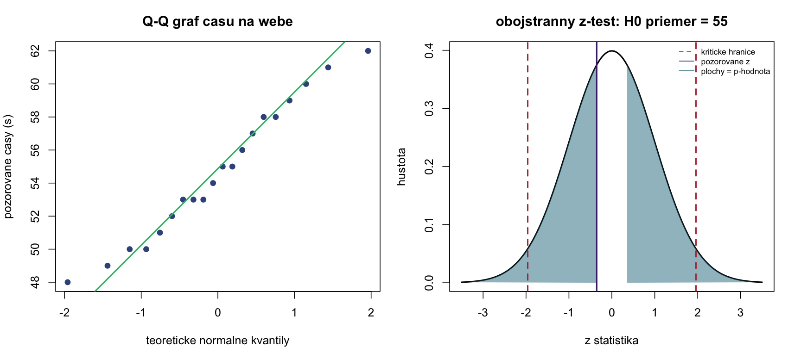

**Ako čítať pravý graf:** Krivka je rozdelenie štatistiky **za nulovej hypotézy**, nie histogram časov. Zafarbené chvosty za $\pm|z|$ tvoria p-hodnotu. Červené čiary pri približne ±1,96 ohraničujú kritické oblasti s celkovou plochou 0,05. P-hodnota a hladina významnosti sú rozdielne plochy.

### 4.3 Jednovýberový t-test

**Prečo:** Ak 3,8 nie je nezávisle známe populačné σ, používame výberovú odchýlku a t-rozdelenie. `t.test(cas)` bez `mu` testuje priemer proti **nule**, preto treba praktickú referenčnú hodnotu uviesť.

```r
test_cas <- stats::t.test(cas, mu = 55, alternative = "two.sided", conf.level = 0.95)
test_cas
test_cas$statistic
test_cas$parameter
test_cas$p.value
test_cas$estimate
test_cas$conf.int
```

**Výstup:** `statistic` je t, `parameter` stupne voľnosti 19, `p.value` približne 0,7474, `estimate` priemer 54,7 a `conf.int` približne [52,7787; 56,6213]. Referenčných 55 leží v obojstrannom 95 % intervale, preto zodpovedajúci obojstranný test na 5 % hladine nezamieta.

**Ako zvoliť smer na praktickej otázke:**

| Otázka určená vopred | Nulová/alternatívna hypotéza | Argument R |
|---|---|---|
| Je priemerný čas iný než 55? | $H_0:\mu=55$, $H_1:\mu\ne55$ | `alternative = "two.sided"` |
| Vieme preukázať priemer nad 58? | $H_0:\mu\leq58$, $H_1:\mu>58$ | `mu = 58, alternative = "greater"` |
| Porušuje sa sľub „aspoň 58“ smerom nadol? | $H_0:\mu\geq58$, $H_1:\mu<58$ | `mu = 58, alternative = "less"` |

```r
stats::t.test(cas, mu = 58, alternative = "greater")
stats::t.test(cas, mu = 58, alternative = "less")
```

Tieto dva príkazy ilustrujú **dve rôzne otázky**. V reálnej analýze si po výsledku nevyberáme ten, ktorý dal menšiu p-hodnotu. Zamietnutie alebo nezamietnutie jednostrannej hypotézy treba vysloviť v jej skutočnom smere.

### 4.4 Príklady: plnička, pizza a batérie

**Prečo sa mení alternatíva:** Dobre nastavená plnička sa môže mýliť oboma smermi; pri pizze nás môže zaujímať prekročenie limitu; pri batérii nedosiahnutie deklarovanej výdrže. Tá istá funkcia rieši rôzne vecné otázky podľa `mu` a `alternative`.

```r
jablko <- c(499.2,496.8,502.1,498.5,501,503,500.7,501.5,501.8,499.1,
            500.9,502.2,501.7,500.4,500.2,501.1,499.9,500.2,501.1,500.8,499.3)
pizza <- c(27,25,30,28,29,24,30,26,28,32,24,32,31,29,28,29,35,34,30,31,18,22)
baterie <- c(18.2,19.6,18.6,19.4,17,18.5,18,18.4,19,18,17.9,18.1)
shapiro.test(jablko)
shapiro.test(pizza)
shapiro.test(baterie)
stats::t.test(jablko, mu = 500, conf.level = 0.90)
stats::t.test(pizza, mu = 30, alternative = "greater")
stats::t.test(baterie, mu = 19, alternative = "less")
```

Plničku posudzujeme obojstranne na hladine **0,10**; jej p-hodnota je približne 0,09, preto na tejto hladine zamietame správne nastavenie priemeru na 500 ml. Na hladine 0,05 by sme nezamietli. Toto nie je rozpor, mení sa vopred zvolený prah.

Pri pizze uvedený test hľadá dôkaz, že priemer **prekračuje** 30 minút; opačná otázka „vieme preukázať priemer pod 30?“ by použila `less`. Ani priemer pod 30 nedokazuje, že **každá** pizza príde do 30 minút. Batérie testujeme proti poklesu pod 19 hodín; reklamované „aspoň“ preto automaticky neznamená `greater`.

### 4.5 Chí-kvadrát test jedného rozptylu

**Otázka:** Je predpoklad $\sigma=3{,}8$ v príklade časov zlučiteľný s dátami? Priemer a variabilita sú rôzne vlastnosti; tento test sa nepýta na 55 s.

$$H_0:\sigma^2=3{,}8^2,\qquad H_1:\sigma^2\ne3{,}8^2.$$

```r
EnvStats::varTest(cas, sigma.squared = 3.8^2, alternative = "two.sided")
q <- (length(cas) - 1)*var(cas)/(3.8^2)
p_var <- min(1, 2*min(pchisq(q, df = length(cas) - 1),
                     pchisq(q, df = length(cas) - 1, lower.tail = FALSE)))
q
p_var
```

Vyjde $Q\approx22{,}1745$, $p\approx0{,}5513$. Rozptyl nezamietame ako nezlučiteľný s referenciou, ale nedokázali sme, že je presne $3{,}8^2$. Test je citlivý na nenormalitu; pre zjavne šikmé časy by mohol poskytovať zavádzajúce rozhodnutie.

### 4.6 Párový t-test a graf pred/po

**Otázka:** Zlepšil tréning rýchlosť tých istých žiakov? Každý riadok musí spájať správneho žiaka pred a po tréningu. Pri nezávislom teste by sme zahodili informáciu, kto je s kým spárovaný.

```r
pred <- c(87,61,98,90,93,74,83,72,81,75,83)
po <- c(50,45,79,90,88,65,52,79,84,61,52)
rozdiel <- pred - po
shapiro.test(rozdiel)
stats::t.test(pred, po, paired = TRUE, alternative = "greater")
stats::t.test(rozdiel, mu = 0, alternative = "greater")

matplot(rbind(pred, po), type = "b", lty = 1, pch = 19,
        col = viridisLite::viridis(3)[2], xaxt = "n",
        xlab = "stav", ylab = "cas riesenia (s)")
axis(1, at = 1:2, labels = c("pred", "po"))
```

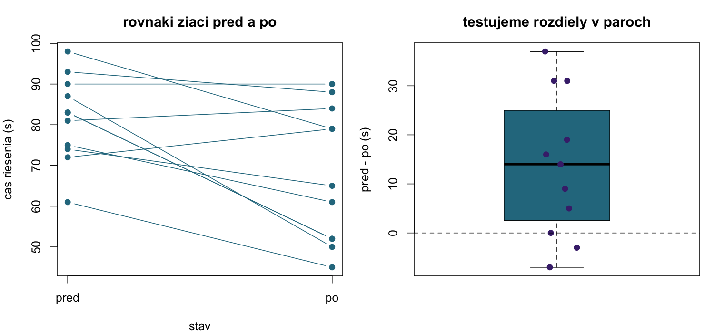

**Prečo graf:** Jedna spojnice znamená jedného žiaka. Vidíme smer aj konzistentnosť zmeny, ktoré by dva samostatné priemery zakryli. Klesajúca čiara znamená skrátenie času. Vpravo kladný rozdiel `pred - po` znamená zlepšenie; niektorí žiaci sa mohli nezlepšiť, aj keď je priemerná zmena významná.

Testujeme $H_0:\mu_D\leq0$ proti $H_1:\mu_D>0$. Priemerné skrátenie je **13,8182 s**, $t\approx3{,}1128$, $p\approx0{,}00550$; na hladine 0,05 máme dôkaz o kladnej priemernej zmene. Normalita sa týka rozdielov. Bez vhodného kontrolovaného návrhu nemožno všetku zmenu automaticky pripísať samotnému tréningu.

[↑ Navigácia](#navigácia-podľa-týždňov)

<a id="tyzden-5"></a>
## 5. týždeň: Nezávislé výbery a ANOVA

**Podklady:** [SADR5.R](05/SADR5.R), [SADR5.pdf](05/SADR5.pdf), [cholesterol.xlsx](05/cholesterol.xlsx), [anova1.xlsx](05/anova1.xlsx), [anova2.xlsx](05/anova2.xlsx), [anova_interakcie.xlsx](05/anova_interakcie.xlsx) · [Teória, vzorce a videá](../prednasky/README.md#tyzden-5)

### 5.1 F-test rozptylov a združený dvojvýberový t-test

**Praktická otázka:** Dva druhy plastov majú nameranú odolnosť. Sú rovnako variabilné a líši sa ich priemerná odolnosť? Ide o dva nezávislé výbery, nie rovnaké kusy pred a po.

```r
prvy <- c(85,87,92,80,84,86)
druhy <- c(89,89,90,84,92)
boxplot(prvy, druhy, names = c("prvy", "druhy"),
        col = viridisLite::viridis(2, end = 0.8), ylab = "odolnost (dni)")
shapiro.test(prvy)
shapiro.test(druhy)
stats::var.test(prvy, druhy)
stats::t.test(prvy, druhy, paired = FALSE, var.equal = TRUE)
```

**Prečo dva testy:** F-test testuje pomer populačných rozptylov voči 1; t-test rozdiel priemerov voči 0. Záver jedného nie je záverom druhého. `var.equal = TRUE` združí rozptyly do spoločného odhadu, takže vyžaduje odôvodnenie tohto predpokladu.

**Ako čítať:** `var.test()` vypíše F, dva stupne voľnosti, interval **pomeru rozptylov** a p-hodnotu. `t.test()` vypíše interval **rozdielu priemerov**. V tomto príklade na hladine 0,05 rozdiel priemerov nepreukážeme; nedokazujeme rovnakú odolnosť ani dostatočnosť lacnejšieho plastu. Pri 6 a 5 meraniach je neistota značná.

F-test je citlivý na nenormalitu. Nezamietnutie rovnosti rozptylov ju nedokazuje a nie je povinnou vstupenkou do Welchovho testu. [Dokumentácia R](https://stat.ethz.ch/R-manual/R-devel/library/stats/html/t.test.html) potvrdzuje, že predvolené `var.equal = FALSE` používa Welcha.

### 5.2 Welchov t-test: odlišná stabilita dodávateľov

**Otázka a dôvod:** Dodávateľ AA má rozptýlenejšie dodacie lehoty než BB. Chceme porovnať priemery bez predpokladu rovnakej variability, preto použijeme Welcha. Vyšší rozptyl neznamená automaticky vyšší priemer.

```r
aa <- c(10,12,15,25,18,20,15,25,30)
bb <- c(15,15,18,10,16,12,15)
mean(aa)
mean(bb)
stats::var.test(aa, bb)
stats::t.test(aa, bb, paired = FALSE, var.equal = FALSE)
```

Pomer výberových rozptylov je približne **6,4167**, F-test má $p\approx0{,}03593$. Priemery sú **18,8889** a **14,4286**, ale Welchov test dá $p\approx0{,}09483$ a 95 % interval rozdielu približne **[−0,9120; 9,8326]** v jednotkách lehôt. Na hladine 0,05 rozdiel priemerov nepreukážeme, aj keď je variabilita zreteľne odlišná. Jednotka lehôt nie je v skripte výslovne uvedená; nevymýšľame ju.

**Praktický význam:** Firma citlivá na oneskorenia môže preferovať stabilnejšie dodávky aj pri nepreukázanom rozdiele priemerov. Na potvrdenie rovnocennosti by bol potrebný inak formulovaný postup s vopred určenou toleranciou.

### 5.3 Jednofaktorová ANOVA: príjem podľa vzdelania

**Otázka:** Sú priemerné príjmy troch kategórií rovnaké? Séria troch neupravených t-testov by zvyšovala riziko aspoň jedného falošného nálezu. ANOVA najprv porovná skupiny spoločne.

```r
data <- as.data.frame(readxl::read_xlsx("cvicenia/03/data_vyuka.xlsx"))
prijmy <- na.omit(data[c("mprij", "vzdelanie")])
prijmy$vzdelanie <- factor(prijmy$vzdelanie)
table(prijmy$vzdelanie)
tapply(prijmy$mprij, prijmy$vzdelanie, mean)
tapply(prijmy$mprij, prijmy$vzdelanie, shapiro.test)
bartlett.test(mprij ~ vzdelanie, data = prijmy)
car::leveneTest(mprij ~ vzdelanie, data = prijmy, center = median)
model_prijem <- aov(mprij ~ vzdelanie, data = prijmy)
summary(model_prijem)
```

Testujeme $H_0:\mu_1=\mu_2=\mu_3$. Faktor musí byť faktorom aj v R; výstup teraz obsahuje **2 stupne voľnosti** pre vzdelanie. V dátach nie je výrazný diagnostický dôkaz proti normalite skupín alebo rovnosti rozptylov. Nezávislosť a reprezentatívnosť sa tým nepotvrdili.

**Ako čítať ANOVA tabuľku:** `Df` sú stupne voľnosti, `Sum Sq` súčty štvorcov, `Mean Sq` ich podiel `Sum Sq / Df`, `F value` pomer medzi- a vnútroskupinovej variability a `Pr(>F)` p-hodnota. Tu $F\approx33{,}72$, $p\approx1{,}84\cdot10^{-9}$: aspoň jeden priemer sa líši. Významné vzdelanie v tomto modeli označuje asociáciu s príjmom; nejde o dôkaz príčiny.

### 5.4 Bartlettov a Leveneov test: prečo kontrolovať rozptyly

**Príklad:** Pri diéte A majú všetci podobnú hodnotu cholesterolu, pri diéte B je rozptyl veľký. Klasická ANOVA by používala jeden spoločný odhad šumu. Ak sa skupiny líšia aj počtom osôb, taký predpoklad môže skresliť test.

`bartlett.test()` testuje rovnosť rozptylov pod normálnym modelom; môže reagovať aj na nenormalitu. `car::leveneTest(..., center = median)` používa absolútne odchýlky od skupinového mediánu a je robustnejšou Brownovou–Forsythovou verziou. `center = mean` dá pôvodný Leveneov variant. [NIST uvádza ich princíp a rozdiely](https://www.itl.nist.gov/div898/handbook/eda/section3/eda35a.htm).

**Ako čítať:** Nulová hypotéza je pri oboch rovnosť rozptylov, nie priemerov. Malé p znamená dôkaz proti spoločnému rozptylu. Veľké p znamená, že sme rozdiel nepreukázali; nemusí to byť dôkaz rovnakej variability. Pri dvojfaktorovom modeli posudzujeme variabilitu v **kombináciách faktorov**, nie iba v každom faktore oddelene.

### 5.5 Tukeyho a Scheffého post-hoc testy

**Prečo po ANOVA:** Významné F neprezradí, ktoré dvojice sa líšia. Tukeyho test cieli na všetky páry a kontroluje rodinnú chybu; Scheffého postup pokrýva aj všeobecnejšie kontrasty a pri dvojiciach býva konzervatívnejší.

```r
tukey <- TukeyHSD(model_prijem, conf.level = 0.95)
tukey
plot(tukey, las = 1)
DescTools::ScheffeTest(model_prijem)
```

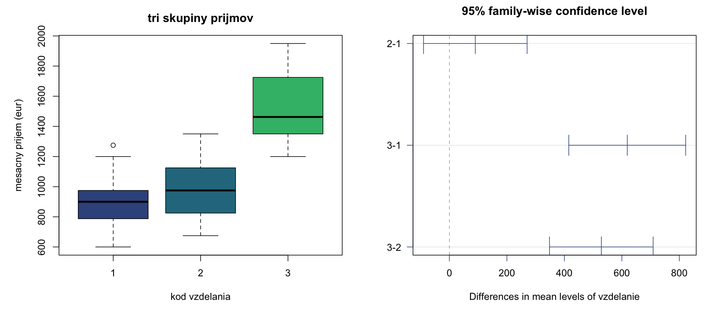

**Ako čítať test a pravý graf:** `diff` je rozdiel priemerov v poradí uvedenej dvojice, `lwr/upr` jeho simultánny interval a `p adj` už upravená p-hodnota. Zvislá nula znamená žiadny rozdiel. Interval celkom napravo od nuly ukazuje kladný rozdiel, celkom naľavo záporný. Ak nulu zahŕňa, na danej rodinnej hladine rozdiel nepreukážeme.

V dátach rozdiel **2 − 1 ≈ 90,18 €** nie je významný (`p adj ≈ 0.4508`), rozdiely **3 − 1 ≈ 618,75 €** a **3 − 2 ≈ 528,57 €** významné sú. Dvojice 1/2 preto neoznačujeme za dokázateľne totožné. Vzdelanostné kódy zodpovedajú v materiáloch ZŠ/SŠ/VŠ; pri novom datasete treba toto mapovanie znovu overiť.

**Prečo je tento graf lepší než porovnanie samostatných intervalov:** Priamo zobrazuje neistotu rozdielu, ktorý testujeme, a zahŕňa ochranu proti viacerým párovým porovnaniam.

### 5.6 Miera efektu: veľkosť rozdielu

**Otázka:** Je rozdiel len ľahko detegovateľný, alebo vysvetľuje veľkú časť variability? P-hodnota sama to nehovorí. Z ANOVA tabuľky získame etu a omegu bez ďalšieho balíka:

```r
tabulka <- summary(model_prijem)[[1]]
sa <- tabulka[1, "Sum Sq"]
se <- tabulka[2, "Sum Sq"]
df_a <- tabulka[1, "Df"]
ms_e <- tabulka[2, "Mean Sq"]
eta2 <- sa/(sa + se)
omega2 <- (sa - df_a*ms_e)/(sa + se + ms_e)
eta2
omega2
```

$\eta^2\approx0{,}6163$ znamená, že medzi kategóriami je približne 61,6 % celkovej výberovej variability príjmov v tomto modeli. $\omega^2$ koriguje nadhodnocovanie. Pri viacerých faktoroch je parciálna eta pre faktor A $S_A/(S_A+S_E)$; nezamieňaj ju s celkovým podielom $S_A/S_T$. Pôvodné cvičenie používa aj `effectsize::eta_squared()`, priamy výpočet vyššie ukazuje, čo sa počíta.

### 5.7 Reziduálne grafy: diagnostika modelu

**Na čo a prečo:** Významná p-hodnota neznamená, že model správne opisuje dáta. Rezíduá sú merané hodnoty mínus predikované skupinové priemery. Ak rozptyl chýb rastie s priemerom alebo majú chyby extrémne chvosty, predpoklady klasickej ANOVA môžu byť problematické.

```r
par(mfrow = c(1, 2))
plot(fitted(model_prijem), residuals(model_prijem), pch = 19,
     xlab = "predikovany prijem", ylab = "reziduum")
abline(h = 0, lty = 2)
qqnorm(residuals(model_prijem), pch = 19)
qqline(residuals(model_prijem))
par(mfrow = c(1, 1))
```

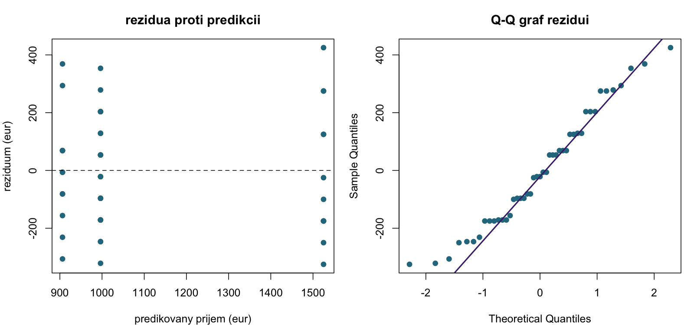

**Ako čítať:** Vľavo chceme podobný zvislý rozptyl okolo nuly; lievikovitý tvar upozorňuje na meniacu sa variabilitu. V jednofaktorovej ANOVA prirodzene vzniknú zvislé pásy, lebo predikcia je v skupine rovnaká. Vpravo hľadáme odchýlky od normálneho tvaru. Tieto grafy neoveria reprezentatívnosť a samy nezaručia nezávislosť meraní.

### 5.8 Welchova ANOVA a Gamesov–Howellov test

**Praktická otázka:** Líši sa priemerný cholesterol troch diétnych skupín, keď majú rozdielne rozptyly? `cholesterol.xlsx` obsahuje 90 meraní. Jednotka cholesterolu nie je v tabuľke uvedená, preto výsledky neoznačujeme automaticky ako mmol/l.

```r
cholesterol <- as.data.frame(readxl::read_xlsx("cvicenia/05/cholesterol.xlsx"))
cholesterol$Dieta <- factor(cholesterol$Dieta)
tapply(cholesterol$Cholesterol, cholesterol$Dieta, shapiro.test)
bartlett.test(Cholesterol ~ Dieta, data = cholesterol)
car::leveneTest(Cholesterol ~ Dieta, data = cholesterol, center = median)
oneway.test(Cholesterol ~ Dieta, data = cholesterol, var.equal = FALSE)
```

Bartlett dá $p\approx2{,}92\cdot10^{-8}$, spoločný rozptyl je neprimeraný predpoklad. Welchova ANOVA dá $p\approx2{,}28\cdot10^{-7}$, takže aspoň jeden populačný priemer sa líši. [Video k obom krokom](https://www.youtube.com/watch?v=n4FhXAMSbco).

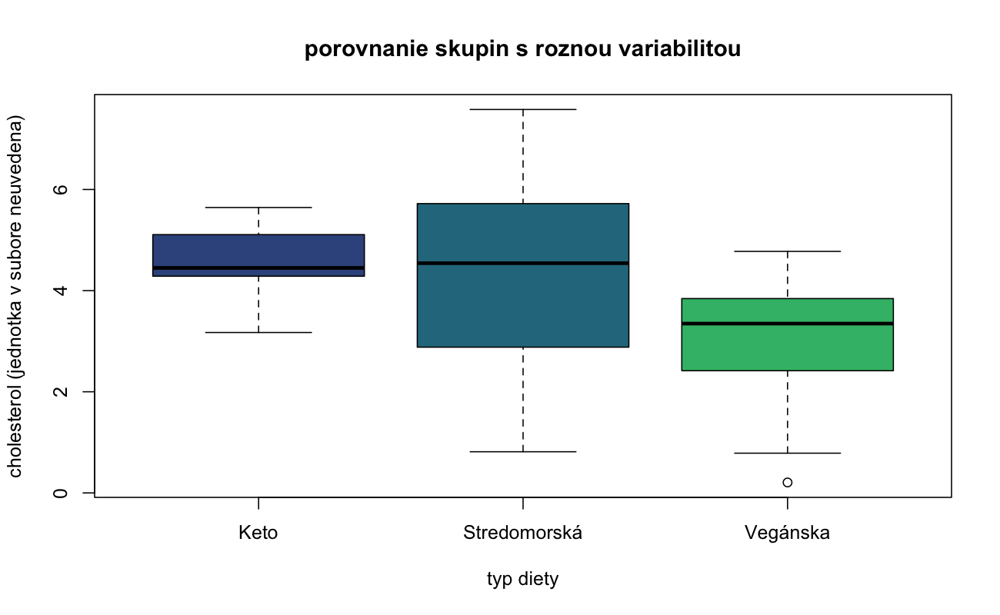

**Ako čítať graf:** Stredné hodnoty aj šírky boxov sa líšia. Porovnanie priemerov preto potrebuje zohľadniť rôznu neistotu; vyšší box nie je sám osebe štatistický test.

**Prečo Games–Howell:** Tukeyho spoločný reziduálny rozptyl by nesedel na Welchov model. Games–Howell pre každú dvojicu použije vlastné rozptyly a stupne voľnosti. Krátky zápis z cvičenia je `rstatix::games_howell_test(cholesterol, Cholesterol ~ Dieta)`; ak tento balík nemáš, rovnaký základný výpočet párov urobíš pomocou R:

```r
pocet <- tapply(cholesterol$Cholesterol, cholesterol$Dieta, length)
priemer <- tapply(cholesterol$Cholesterol, cholesterol$Dieta, mean)
rozptyl <- tapply(cholesterol$Cholesterol, cholesterol$Dieta, var)
pary <- combn(seq_along(pocet), 2)
gh <- data.frame(
  skupina1 = names(pocet)[pary[1, ]], skupina2 = names(pocet)[pary[2, ]],
  rozdiel = NA_real_, dolna = NA_real_, horna = NA_real_, p_upravena = NA_real_
)
for (i in seq_len(ncol(pary))) {
  a <- pary[1, i]
  b <- pary[2, i]
  va <- rozptyl[a]/pocet[a]
  vb <- rozptyl[b]/pocet[b]
  df <- (va + vb)^2/(va^2/(pocet[a] - 1) + vb^2/(pocet[b] - 1))
  rozdiel <- priemer[a] - priemer[b]
  chyba <- sqrt((va + vb)/2)
  hranica <- qtukey(0.95, nmeans = length(pocet), df = df)*chyba
  gh[i, 3:6] <- c(rozdiel, rozdiel - hranica, rozdiel + hranica,
                  ptukey(abs(rozdiel)/chyba, nmeans = length(pocet),
                         df = df, lower.tail = FALSE))
}
gh
```

**Ako čítať:** `rozdiel` je skupina1 mínus skupina2; interval a `p_upravena` zohľadňujú všetky páry. V dátach nepreukážeme rozdiel Keto/Stredomorská, ale preukážeme rozdiel oboch s Vegánskou. Priemery sú približne **4,5343 / 4,2769 / 3,0781**. Poradie znamienok môže byť v inom balíku obrátené, preto vždy čítaj názvy skupín. Ďalšia Bonferroniho korekcia na tieto už upravené p-hodnoty sa nepridáva. [Princíp výpočtu v dokumentácii rstatix](https://rpkgs.datanovia.com/rstatix/reference/games_howell_test.html).

### 5.9 Kruskalov–Wallisov test ako alternatíva

**Na čo a prečo:** Pri silne šikmých alebo ordinálnych nezávislých skupinách môže byť vhodnejšie porovnávať poradia. Pre rovnaké príjmové dáta možno demonštrovať zápis:

```r
kruskal.test(mprij ~ vzdelanie, data = prijmy)
```

Test sa týka rozdielov rozdelení podľa poradí; ako rozdiel polohy/mediánov ho interpretujeme pri porovnateľných tvaroch skupín. Nejde o identický test rovnosti priemerov ako ANOVA. Ani tento test neodstráni závislé merania alebo nevhodný zber dát. V materiáloch sa uvádza ako alternatíva, nie ako povinný ďalší test po každej ANOVA.

### 5.10 Dvojfaktorová ANOVA: laborant a prístroj

**Praktická otázka:** Mení sa nameraná hodnota DEG podľa laboranta, prístroja alebo ich kombinácie? Dve oddelené jednofaktorové analýzy by nedokázali správne oddeliť oba zdroje rozdielov a skúmať interakciu.

```r
merania <- as.data.frame(readxl::read_xlsx("cvicenia/05/anova1.xlsx"))
merania$laborant <- factor(merania$laborant)
merania$pristroj <- factor(merania$pristroj)
with(merania, table(laborant, pristroj))
merania$bunka <- interaction(merania$laborant, merania$pristroj)
tapply(merania$deg, merania$bunka, shapiro.test)
car::leveneTest(deg ~ bunka, data = merania, center = median)

model_aditivny <- aov(deg ~ laborant + pristroj, data = merania)
summary(model_aditivny)
model_plny <- aov(deg ~ laborant * pristroj, data = merania)
summary(model_plny)
anova(model_aditivny, model_plny)
TukeyHSD(model_aditivny)
```

**Prečo tieto dva modely:** Aditívny predpokladá rovnaký efekt laboranta naprieč prístrojmi. Plný dovoľuje, aby konkrétny laborant na konkrétnom prístroji reagoval inak. Porovnanie vnorených modelov testuje prínos interakcie.

V aditívnom modeli sú laborant aj prístroj štatisticky významné. V plnom modeli má interakcia približne **p = 0,1052**, preto ju na hladine 0,05 nepreukážeme; netvrdíme, že je nulová. V bunkách sú iba 3–4 merania, takže diagnostika a sila interakčného testu majú obmedzenia.

**Dôležité pri týchto dátach:** Dizajn nie je úplne vyvážený. `summary(aov(...))` používa sekvenčné súčty štvorcov: druhý faktor sa posudzuje po prvom a výsledok môže závisieť od poradia. Preto závery jasne priraďujeme uvedenému modelu. Tukeyho výstup z pôvodného cvičenia je užitočná ukážka, ale pri nevyváženom dizajne treba pri formálnej interpretácii zvážiť modelovo upravené kontrasty a zvolený typ súčtov štvorcov. [Dokumentácia aov](https://stat.ethz.ch/R-manual/R-devel/library/stats/html/aov.html).

Súbor `anova2.xlsx` je ďalší tréningový dvojfaktorový dataset so stĺpcami `strava`, `trening`, `body`. Číselné kódy oboch faktorov treba previesť na kategórie:

```r
sport <- as.data.frame(readxl::read_xlsx("cvicenia/05/anova2.xlsx"))
sport$strava <- factor(sport$strava)
sport$trening <- factor(sport$trening)
model_sport <- aov(body ~ strava * trening, data = sport)
summary(model_sport)
```

Pred vecným záverom aj tu over nezávislosť, bunkové počty, rozptyly a rezíduá. Samotný názov faktora neurčuje, že išlo o randomizovaný experiment.

### 5.11 Interakčný graf: prečo hlavný priemer nestačí

**Otázka:** Zhoršuje vysoká latencia dokončenie úlohy rovnako pri jednoduchom aj zložitom UI? Ak nie, jedno priemerné číslo pre latenciu skryje dôležitý rozdiel.

```r
web <- as.data.frame(readxl::read_xlsx("cvicenia/05/anova_interakcie.xlsx"))
web$latencia <- factor(web$latencia, levels = c("Nízka", "Vysoká"))
web$ui <- factor(web$ui, levels = c("Jednoduché", "Zložité"))
web$bunka <- interaction(web$latencia, web$ui)
tapply(web$cas, web$bunka, shapiro.test)
car::leveneTest(cas ~ bunka, data = web, center = median)
model_web <- aov(cas ~ latencia * ui, data = web)
summary(model_web)
with(web, tapply(cas, list(latencia, ui), mean))

interaction.plot(web$latencia, web$ui, web$cas, fun = mean,
                 type = "b", col = viridisLite::viridis(2, end = 0.8),
                 pch = c(19, 17), trace.label = "typ ui",
                 xlab = "latencia siete", ylab = "priemerny cas (s)")
```

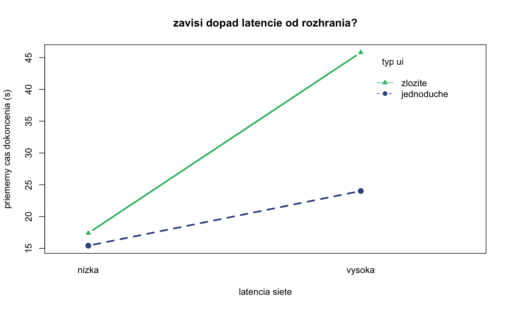

**Ako a prečo čítať sklony:** Pri nízkej latencii sú priemery približne **15,42 a 17,39 s**. Pri vysokej **24,02 a 45,81 s**. Zvýšenie latencie teda pridáva približne **8,60 s** jednoduchému UI, ale **28,42 s** zložitému. Účinky sa nedajú opísať iba dvoma samostatnými konštantnými prírastkami.

Neparalelné čiary naznačujú interakciu; nemusia sa pretínať. Samotný graf nezobrazuje neistotu priemerov a významnosť z neho neurčíme. Riadok `latencia:ui` v klasickom modeli má **p ≈ 1,38 · 10⁻⁹**.

**Čo odhalila diagnostika:** Uvedený Leveneov test pre kombinácie faktorov dá **p ≈ 0,007317**, teda homogenitu rozptylov zamietame. Klasická ANOVA tu slúži na reprodukciu prednáškového postupu a jej p-hodnota má toto obmedzenie; samotná malá hodnota nenahrádza kontrolu predpokladov. Graf a rozdiely priemerov ukazujú výrazný interakčný vzor, ale na formálne potvrdenie s primerane kalibrovanou neistotou treba metódu zohľadňujúcu rôzne rozptyly buniek. Bežná jednofaktorová Welchova ANOVA sama nenahrádza test dvojfaktorovej interakcie.

**Praktický záver:** Pri zhoršenej sieti je rozdiel medzi UI oveľa väčší. Preto interpretujeme kombinácie podmienok a jednoduché účinky, nie iba tvrdenie „zložité UI je v priemere pomalšie“. Významná interakcia nevylučuje existenciu priemerných hlavných účinkov, ale tie samy podstatný vzor nevysvetľujú.

[↑ Navigácia](#navigácia-podľa-týždňov)

<a id="doplnky"></a>
## Doplnkové pracovné listy

Tieto súbory nemajú jednoznačné priradenie ku kalendárnemu týždňu, preto ich nenazývame novými prebranými týždňami.

### Odhady a intervaly zo súhrnných údajov

[cv_5.pdf](05/cv_5.pdf) napriek umiestneniu obsahuje hlavne odhady a intervaly: aktualizáciu priemeru/rozptylu po zmene dát a intervaly priemeru, rozptylu či odchýlky.

**Prečo:** Niekedy máme iba rozsah, priemer a rozptyl, nie pôvodné merania. Pre 12 LED diód s priemernou životnosťou 45 000 h a odchýlkou 2 500 h môžeme t-interval vypočítať priamo:

```r
n_led <- 12
priemer_led <- 45000
sd_led <- 2500
priemer_led + c(-1, 1)*qt(0.975, df = n_led - 1)*sd_led/sqrt(n_led)
```

Pri aktualizácii používame súčet $S_1=n\bar x$ a súčet štvorcov $S_2=(n-1)s^2+n\bar x^2$. Po pridaní/odobratí hodnôt upravíme oba súčty aj počet a vypočítame $\bar x_{nové}=S_1/n_{nové}$ a $s^2_{nové}=(S_2-S_1^2/n_{nové})/(n_{nové}-1)$. Odstraňovať extrémy len kvôli užšiemu intervalu nie je odôvodnené.

V pracovnom liste sú aj nezrovnalosti: pri kondenzátoroch text uvádza osem meraní, ale vypísaných je sedem. V príklade rezistorov malé uvedené $s^2=0{,}81$ nie je zlučiteľné s dvoma údajnými hodnotami 105 a 106 pri $n=25$ a priemere 99,7; samotné tieto dve odchýlky prekračujú celkový uvedený súčet štvorcov. Pred výpočtom treba také zadanie opraviť, nie dosadiť záporný „rozptyl“.

### Staršie príklady z pravdepodobnosti a testov

[M4_pr.pdf](M4_pr.pdf) je zbierka starších otázok. Dopĺňa podmienenú pravdepodobnosť, diskrétne rozdelenia, normalizáciu hustoty, transformácie a chí-kvadrát test zhody.

| Téma | Na čo slúži a prečo | R / vzťah |
|---|---|---|
| Podmienená pravdepodobnosť | Upravuje informáciu po zistení ďalšej udalosti, napríklad pri dvoch ťahoch z urny. | $P(A\mid B)=P(A\cap B)/P(B)$; celková pravdepodobnosť sčíta všetky možné prvé ťahy. |
| Binomické rozdelenie | Počet úspechov v pevnom počte nezávislých pokusov s rovnakým p. | Pre 10 ľudí a p = 0,3: `dbinom(6, 10, 0.3)` presne šesť, `pbinom(5, 10, 0.3)` najviac päť. |
| Geometrické rozdelenie | Čakanie na prvý úspech. | R počíta **neúspechy pred úspechom**: pre počet hodov do prvej jednotky `dgeom(4 - 1, 1/6)` znamená presne štyri hody. |
| Hypergeometrické rozdelenie | Výber bez vracania, preto sa pravdepodobnosť úspechu medzi ťahmi mení. | `phyper(2, m = 10, n = 20, k = 5, lower.tail = FALSE)` dá aspoň tri prvočísla pri piatich číslach z 1–30. |
| Hustota a CDF | Konštantu hustoty určíme z celkovej plochy 1; intervalovú pravdepodobnosť z integrálu. | Pre $f(t)=ce^{-2t}$, $t\geq0$, vyjde $c=2$; `pexp(2, rate = 2) - pexp(0, rate = 2)` je $P(0<X<2)$. |
| Lineárna transformácia | Zmena jednotiek či kalibrácia: mení priemer aj variabilitu. | Ak $Y=3X-5$, potom $E(Y)=3E(X)-5$, $D(Y)=9D(X)$. |

**Chí-kvadrát test zhody početností:** Chceme vedieť, či generátor produkuje čísla 1–5 rovnomerne. Nulová hypotéza určuje pravdepodobnosť každej kategórie 0,2; nie je to test normality ani rozptylu:

```r
pozorovane <- c(10, 40, 20, 10, 20)
test_zhody <- chisq.test(pozorovane, p = rep(0.2, 5))
test_zhody
test_zhody$expected
```

**Prečo:** Porovnáva pozorované a očakávané počty cez $\sum_j(O_j-E_j)^2/E_j$. Tu sú očakávané počty 20, štatistika 30 a stupne voľnosti 4; rovnomernosť zamietame na hladine 0,05. Test vyžaduje nezávislé pozorovania a dostatočné očakávané početnosti. Ani nezamietnutie rovnomernosti by nedokázalo časovú náhodnosť generátora.

**Videá:** [StatQuest — Conditional Probability](https://youtu.be/_IgyaD7vOOA), [Binomial Distribution and Test](https://youtu.be/J8jNoF-K8E8), [MIT — videá z pravdepodobnosti](https://ocw.mit.edu/courses/res-6-012-introduction-to-probability-spring-2018/resources/lecture-videos/) pre geometrické/spojité modely a [JB Statistics — Chi-square Tests](https://www.jbstatistics.com/category/chi-square-tests/) pre test zhody.

<a id="obrazky"></a>
## Ako obnoviť obrázky a overiť príklady

Obrázky sú uložené lokálne, takže sa zobrazia aj bez načítavania vzdialených obrázkov. Generuje ich [generovat_grafy.R](obrazky/generovat_grafy.R). Z koreňa repozitára spusti:

```sh
Rscript cvicenia/obrazky/generovat_grafy.R
```

Skript používa `ggplot2`, `viridisLite`, `readxl` a `vioplot`. Obnoví PNG a prepíše iba svoje obrázky v `cvicenia/obrazky`. Simulácie majú pevný seed; drobné rozdiely fontov môžu závisieť od systému. Obrázky s príjmami používajú 45 úplných relevantných pozorovaní.

Číselné príklady a základné výpočty Gamesovho–Howellovho testu sú spustiteľné uvedenými blokmi bez vlastných funkcií. Odkazy na `effectsize`, `rstatix`, `mice`, `Amelia` a export cez `writexl` vysvetľujú alternatívy z materiálov; nie sú potrebné na spustenie hlavných príkladov a obrázkov. Teoretické vzorce, ďalšie videá a predpoklady sú pri [príslušných týždňoch prednášok](../prednasky/README.md).
